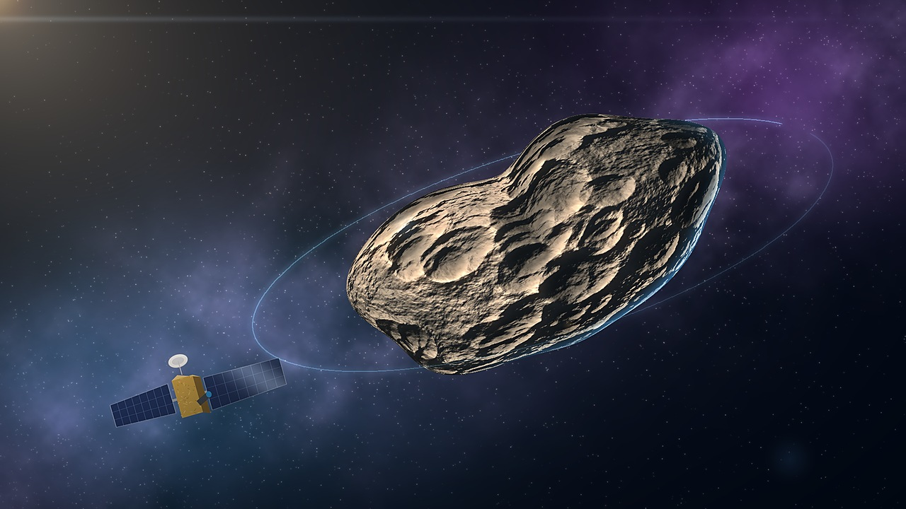
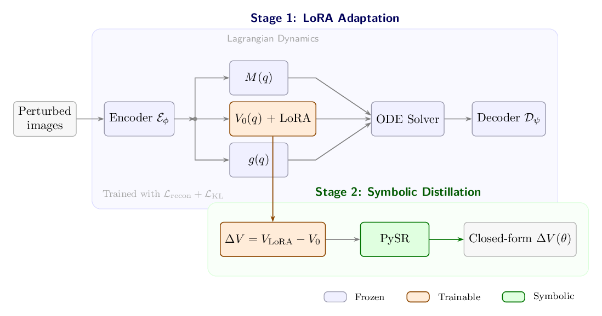
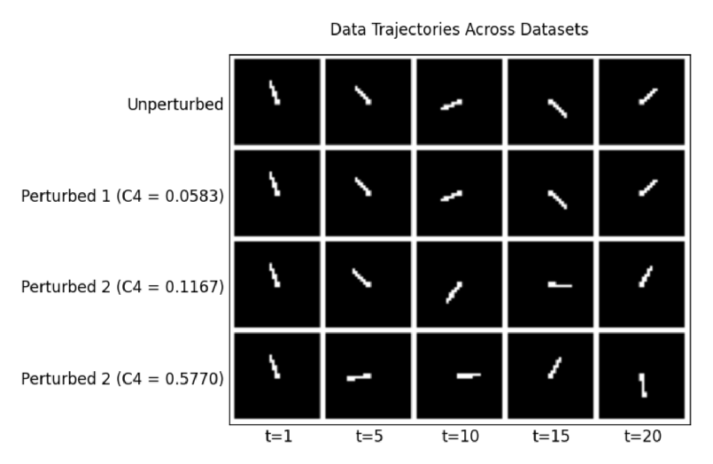
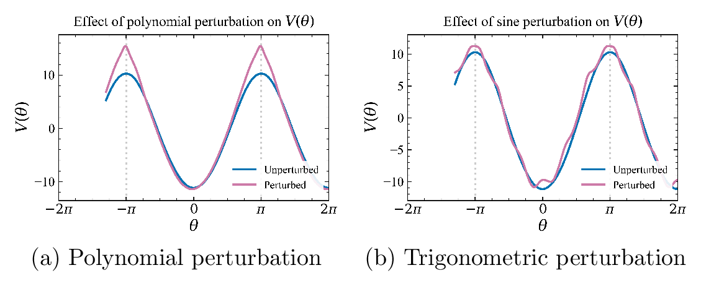

<h1 class="pp-title">Interpretability of Latent Spaces in Variational Autoencoders</h1>

Learning Structure-Preserving Perturbations to Potential Energy Fields from Images

  <i class="fas fa-trophy"></i>Published · L4DC Late-Breaking Results
  <i class="fas fa-chalkboard-teacher"></i>Advisor: <a href="https://engineering.wisc.edu/directory/profile/harsh-sharma/">Dr. Harsh Sharma</a>
  <i class="fas fa-university"></i>UW–Madison

  <a class="btn btn-primary" href="https://drive.google.com/file/d/1ah0ZCWhyw6JVL9xBSy8F6YzakosQOd2D/view?usp=sharing"><i class="fas fa-file-pdf"></i>Read the Paper</a>

  TL;DR
  A model watches a few <b>images</b> of a moving body, works out how the forces acting on it have changed, and writes that change as a <b>short equation</b> a physicist can read.

  
0.7%coefficient error on the recovered equation

  
~9 minend-to-end on a plain CPU

  
2perturbation families recovered

  
1network adapted — the rest stays frozen

<h3 class="pp-h"><i class="fas fa-rocket"></i>Why it matters</h3>

  

    <i class="fas fa-globe-americas"></i>
    <h5>Asteroids are lumpy</h5>
    
Their uneven mass distribution shapes how things move around them, but it's very hard to measure directly.

  

  

    <i class="fas fa-route"></i>
    <h5>Orbits are expensive</h5>
    
The classic approach tracks a spacecraft's orbit up close, which is hard in weak gravity and with external disturbances.

  

  

    <i class="fas fa-camera"></i>
    <h5>Cameras are cheap</h5>
    
So: infer the change in the force field <b>from images alone</b>. This is also useful for satellite servicing and space-debris removal.

  

<h3 class="pp-h"><i class="fas fa-cogs"></i>How it works</h3>

  

    0
    <h5>Learn the physics</h5>
    
A <b>VAE</b> compresses images into an interpretable coordinate <i>q</i>, and <b>Lagrangian dynamics</b> (energy, mass, control) are learned in that latent space.

  

  

    1
    <h5>Adapt with LoRA</h5>
    
On new images of the <i>perturbed</i> system, freeze everything and fine-tune only the energy network with <b>low-rank adapters</b>. The difference is ΔV.

  

  

    2
    <h5>Distill to an equation</h5>
    
<b>Symbolic regression (PySR)</b> turns the black-box ΔV into the simplest closed-form equation that fits, guided by physics-aware operator choices.

  

<figure class="pp-figure">
  

  <figcaption>The two-stage pipeline: LoRA adapts the latent potential, then PySR distills it into a formula.</figcaption>
</figure>

<h3 class="pp-h"><i class="fas fa-chart-line"></i>Results</h3>

Tested on a pendulum (gravity as the baseline) under two physically motivated perturbations: <b>polynomial</b> (irregular mass) and <b>trigonometric</b> (planetary oblateness).

<figure class="pp-figure pp-narrow">
  

  <figcaption>What the model sees: pendulum frames drifting apart as the perturbation C4θ4 grows.</figcaption>
</figure>

<table class="pp-table">
  <thead><tr><th>True perturbation</th><th>Recovered coefficient</th><th>Error</th></tr></thead>
  <tbody>
    <tr class="pp-best"><td>0.0583 θ4 (mild)</td><td>0.0579</td><td>0.7%</td></tr>
    <tr><td>0.1167 θ4 (moderate)</td><td>0.1076</td><td>7.8%</td></tr>
    <tr><td>0.5770 θ4 (strong)</td><td>0.5251</td><td>9.0%</td></tr>
  </tbody>
</table>

  

    <i class="fas fa-check-circle"></i>
    <h5>Right equation shape</h5>
    
The correct <i>form</i> of the perturbation was found in both settings: θ4 terms for polynomial, cosine terms for trigonometric.

  

  

    <i class="fas fa-wave-square"></i>
    <h5>3.6–4.7% frequency error</h5>
    
For oblateness-style perturbations, the recovered oscillation frequency stayed within about 5% of the true value.

  

  

    <i class="fas fa-microchip"></i>
    <h5>Runs on a CPU</h5>
    
The whole pipeline takes about 9 minutes on a CPU, which is promising for resource-limited onboard computers.

  

<figure class="pp-figure">
  

  <figcaption>How each perturbation reshapes the potential energy V(θ).</figcaption>
</figure>

<h3 class="pp-h"><i class="fas fa-tools"></i>Built with</h3>

  PythonPyTorchVariational AutoencodersLagrangian Neural NetworksNeural ODEsLoRAPySR

  <a class="btn btn-outline-primary" href="https://drive.google.com/file/d/1ah0ZCWhyw6JVL9xBSy8F6YzakosQOd2D/view?usp=sharing"><i class="fas fa-file-pdf"></i>Read the Paper</a>

